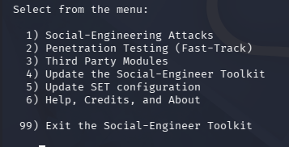
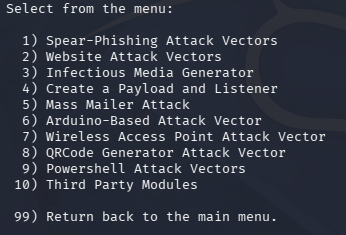
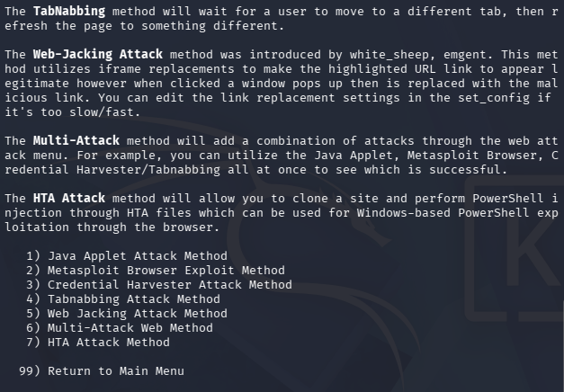
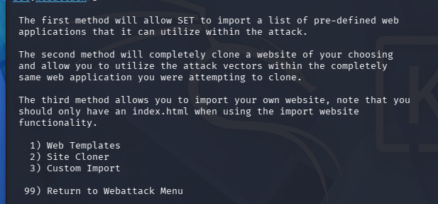

# Phishing with Kali Linux

[🇧🇷 Versão em português](README.md)

A learning project developed as part of my **Cybersecurity studies**, using Kali Linux and the **Social-Engineer Toolkit (SEToolkit)** to explore phishing and social engineering concepts in a controlled lab.

> [!CAUTION]
> **Educational use only.** Test only systems you own or have explicit permission to assess. Use fictional pages and test data. Do not reproduce real services' login pages, collect credentials, or target users without consent.

## Learning objectives

- Understand phishing and its risks.
- Become familiar with the SEToolkit interface and categories.
- Study social engineering from offensive and defensive perspectives.
- Review networking, IP addressing, and HTTP fundamentals.
- Recognize signs of fraudulent pages and messages.
- Document the lab and prevention practices.

## Tools and lab environment

| Item | Purpose |
| --- | --- |
| Kali Linux | Lab operating system |
| VirtualBox | Virtual machine platform |
| SEToolkit | Educational exploration of social engineering concepts |
| Bridged Adapter | Connects the VM to the local network when required |

## Environment setup

Start the Kali Linux VM in VirtualBox. If the exercise requires communication with other devices, configure networking according to the instructor-approved lab topology.

Check the network interface and IP address:

~~~bash
ip -br addr
~~~

Inspect the default route and gateway:

~~~bash
ip route
~~~

> The VM address may belong to different private ranges, such as **192.168.x.x** or **10.x.x.x**, depending on the network. A 10.x.x.x address does not, by itself, mean Bridged mode has failed.

Launch SEToolkit if it is already installed:

~~~bash
sudo setoolkit
~~~

Available features and menu organization may vary between versions.

## Lab screenshots

These images document screens observed while exploring the interface. They are visual references, not instructions for running campaigns against third parties.

### 1. Main menu

The initial menu displays categories such as Social-Engineering Attacks, Penetration Testing (Fast-Track), third-party modules, and configuration options.

### 2. Social engineering categories

This screen lists categories such as spear-phishing, web attack vectors, infectious media, and other modules. The presence of an option does not make its use appropriate outside an authorized scope.

### 3. Module descriptions

This screenshot records descriptions displayed by the tool for selected modules and methods. The purpose is to recognize the terminology and understand the associated risks.

### 4. Web attack vectors

The interface displays web application options, including templates, cloning, and page import. This screen is documented only to become familiar with the interface. No procedures are provided for cloning real pages or collecting credentials.

## Concepts covered

- Phishing and spear-phishing
- Social engineering
- Private and public IP addresses
- NAT and Bridged networking in virtualized environments
- TCP/IP fundamentals
- HTTP requests and web forms
- Application security and user awareness

## Lab safety and boundaries

- Use only environments and assets you own or are explicitly authorized to test.
- Prefer demonstration pages created specifically for the lab.
- Use fictional accounts and test data only.
- Do not store or share passwords, tokens, or personal information.
- Do not expose VM services to the internet unless necessary and properly secured.
- Stop test services and remove temporary data when finished.

## Next steps

- Record the Kali Linux and SEToolkit versions used.
- Document safe simulations using fictional data.
- Add phishing indicators and prevention strategies.
- List course references and learning materials.

## Final notes

This repository is a technical learning log. Its purpose is to understand how social engineering is represented in security tools, recognize related risks, and build knowledge that also supports prevention and incident response.

**Educational purposes and authorized testing only.**
