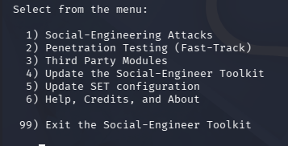
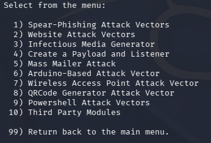
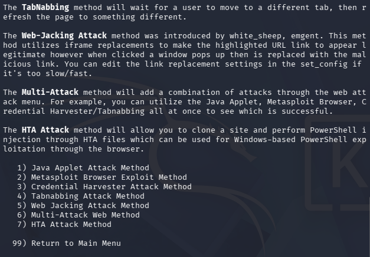
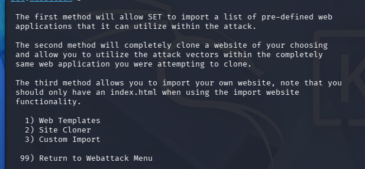

# Phishing com Kali Linux

[🇺🇸 English version](README.en.md)

Projeto de estudo desenvolvido durante meus estudos de **Cybersecurity**, utilizando Kali Linux e o **Social-Engineer Toolkit (SEToolkit)** para conhecer conceitos de phishing e engenharia social em um laboratório controlado.

> [!CAUTION]
> **Uso exclusivamente educacional.** Testes somente em sistemas próprios ou com autorização explícita. Utilize páginas fictícias e dados de teste. Não reproduza páginas de serviços reais, colete credenciais ou direcione usuários sem consentimento.

## Objetivos

- Entender phishing e seus riscos.
- Conhecer a interface e as categorias do SEToolkit.
- Estudar engenharia social sob perspectivas ofensiva e defensiva.
- Revisar redes, endereçamento IP e HTTP.
- Reconhecer sinais de páginas e mensagens fraudulentas.
- Documentar o laboratório e medidas de prevenção.

## Ferramentas e ambiente

| Item | Utilização |
| --- | --- |
| Kali Linux | Sistema operacional do laboratório |
| VirtualBox | Execução da máquina virtual |
| SEToolkit | Exploração didática de conceitos de engenharia social |
| Adaptador Bridge | Conexão da VM à rede local, quando necessária |

## Preparação do ambiente

Inicie a VM Kali Linux pelo VirtualBox. Se o exercício exigir comunicação com outros dispositivos, configure a rede conforme a topologia autorizada pelo instrutor.

Confira a interface e o endereço IP:

~~~bash
ip -br addr
~~~

Consulte a rota padrão e o gateway:

~~~bash
ip route
~~~

> O endereço da VM pode pertencer a diferentes faixas privadas, como **192.168.x.x** ou **10.x.x.x**, conforme a rede. Um endereço 10.x.x.x não significa, por si só, que o modo Bridge falhou.

Para abrir o SEToolkit, caso já esteja instalado:

~~~bash
sudo setoolkit
~~~

A disponibilidade dos recursos e a organização dos menus podem variar conforme a versão.

## Registros do laboratório

As imagens documentam telas observadas durante a exploração da interface. São referências visuais dos menus, não instruções para executar campanhas contra terceiros.

### 1. Menu principal

O menu inicial apresenta categorias como Social-Engineering Attacks, Penetration Testing (Fast-Track), módulos de terceiros e opções de configuração.

### 2. Categorias de engenharia social

A tela apresenta categorias como spear-phishing, vetores web, mídias removíveis e outros módulos. A presença de uma opção na ferramenta não torna seu uso apropriado fora de um escopo autorizado.

### 3. Descrições de módulos

Captura das descrições exibidas pela ferramenta para alguns módulos e métodos. O objetivo é reconhecer a terminologia e compreender os riscos associados.

### 4. Vetores de ataque web

A interface apresenta opções relacionadas a aplicações web, incluindo modelos, clonagem e importação de páginas. Esta tela é documentada apenas para reconhecimento da interface. Não são fornecidos procedimentos para clonar páginas reais ou capturar credenciais.

## Conceitos estudados

- Phishing e spear-phishing
- Engenharia social
- Endereços IP privados e públicos
- NAT e Bridge em ambientes virtualizados
- Fundamentos de TCP/IP
- Requisições HTTP e formulários web
- Segurança de aplicações e conscientização dos usuários

## Boas práticas e limites

- Utilize somente ambientes e ativos próprios ou com autorização documentada.
- Prefira páginas de demonstração criadas para o laboratório.
- Use exclusivamente contas e dados fictícios.
- Não armazene nem compartilhe senhas, tokens ou dados pessoais.
- Não exponha serviços da VM à internet sem necessidade e controles adequados.
- Ao finalizar, encerre os serviços de teste e remova dados temporários.

## Próximos passos

- Registrar as versões do Kali Linux e do SEToolkit utilizadas.
- Documentar simulações seguras com dados fictícios.
- Adicionar indicadores de phishing e estratégias de prevenção.
- Registrar referências e materiais do curso.

## Considerações finais

Este repositório é um diário técnico de aprendizagem. O foco é compreender como a engenharia social é apresentada em ferramentas de segurança, reconhecer riscos e desenvolver conhecimentos úteis também para prevenção e resposta a incidentes.

**Somente para fins educacionais e testes autorizados.**
